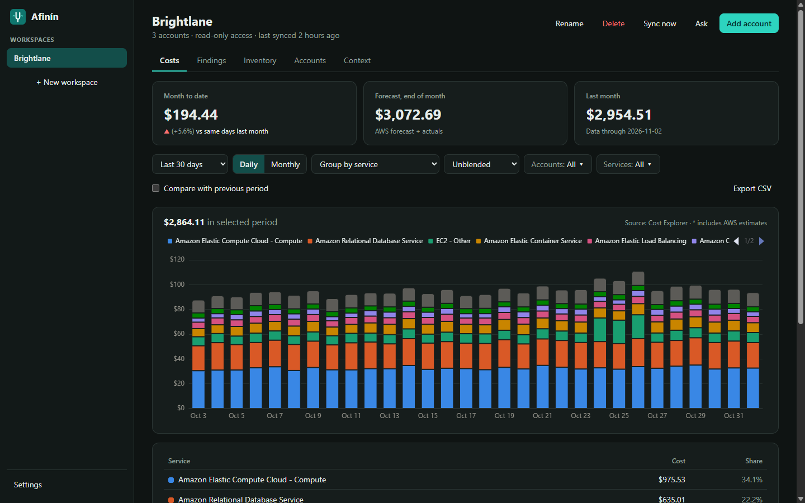
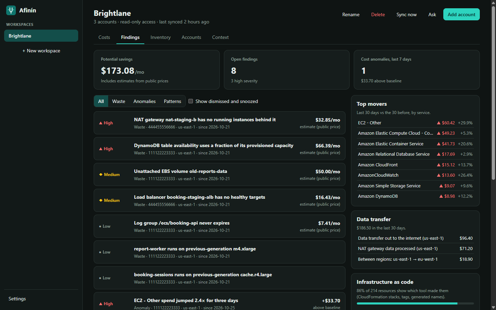
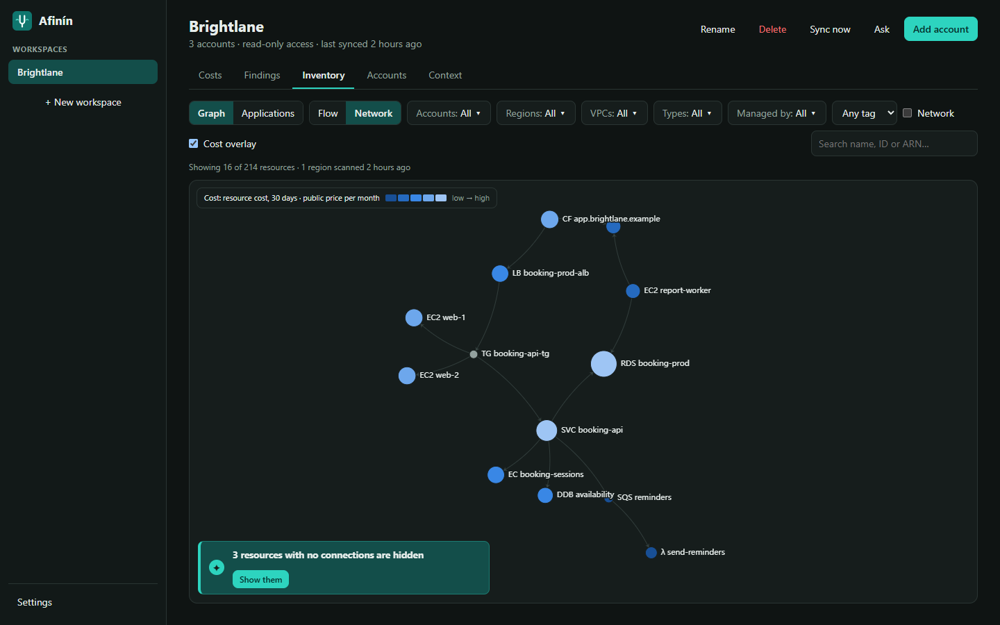
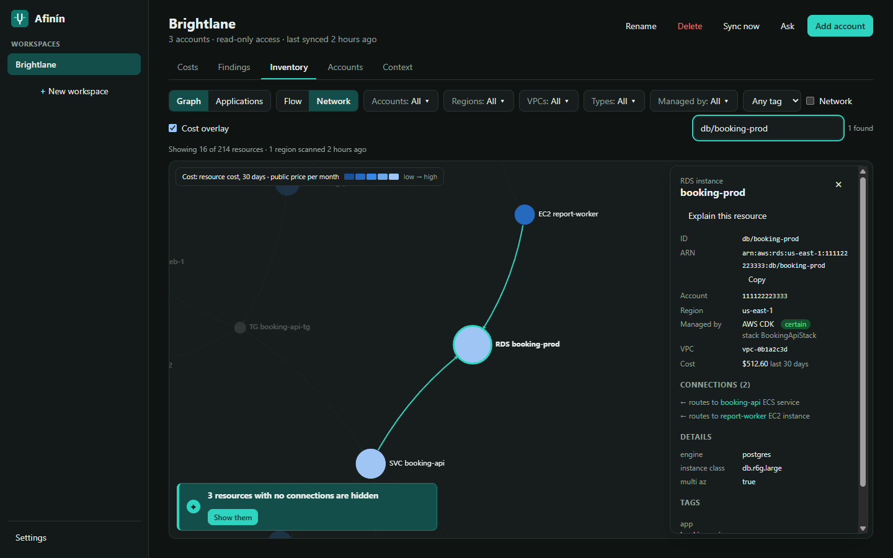
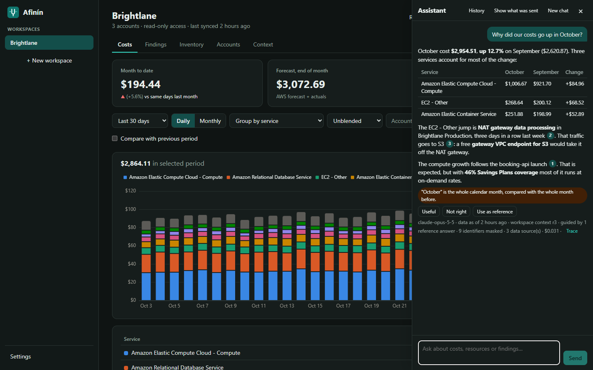

# Afinín

> *Tune your AWS spend. See where the money goes, locally and safely.*

Afinín (from *afinar*, to tune an instrument) is a desktop app for macOS, Windows and Linux. It
connects **read-only** to your AWS accounts, shows where the money goes and how your services
connect, and points at what to fix, with an optional AI assistant that works with any LLM.



*Screens show Brightlane, a fictional company (demo mode, sample data).*

## Why try it

The AWS console tells you what you spent. Afinín tells you **why**, and **what to do about it**.

- **Read-only, by design.** Afinín asks for list, describe and get permissions only. The code
  contains no AWS write call, and CI checks this on every change. It can't stop, delete or
  change anything in your accounts.
- **Your data stays on your machine.** Costs, inventory and findings live in an encrypted
  local database, with the key in your OS keychain. No Afinín server, no account, no telemetry.
- **Cheap to run.** Cost Explorer charges $0.01 per request, and a sync makes about six per
  account: around $2 a month per account with the default daily sync. Settings shows exactly
  what Afinín has cost you.
- **Every account in one place.** Group accounts into workspaces and see them together,
  through IAM Identity Center, CLI profiles or assume-role chains.
- **AI that shows its work, or none at all.** The assistant is optional. When you use it,
  the model gets its numbers from Afinín's own queries, each answer cites them, and any figure
  that matches none of them is flagged as unverified. Account IDs, ARNs and IPs are masked before
  anything leaves your machine.
- **Open source**, MIT or Apache-2.0.

## What it does

### Where the money goes

Month to date, forecast and month-over-month at a glance. Break costs down by account,
service, region, usage type or tag; compare two periods; export any view to CSV. Connect a
CUR 2.0 export and costs go down to each resource.

### What to fix, and what it saves



Waste rules, each with an estimated monthly saving and how to fix it:
- unattached volumes, idle IPs, load balancers and NAT gateways;
- stopped instances still paying for disks, and old snapshots;
- over-provisioned DynamoDB tables, log groups that never expire;
- unused secrets and keys, and previous-generation instance types.

Next to them: cost anomalies against your own baseline, top movers, data transfer,
Savings Plans and RI coverage, tag coverage, and how much of your infrastructure is managed
as code.

### What you have and how it connects



Resources across every enabled region, with the relationships between them inferred: CloudFront
→ load balancer → targets → databases, queues → functions, and more. The cost overlay shows
where the money sits; filter by account, region, VPC, type, tag or the IaC tool that made
it (CloudFormation, CDK, Terraform…).



### Ask in plain language



"Why did costs go up in October?", "What's connected to this database?", "What are my top
savings?" The assistant answers from your synced data with a local model (Ollama, LM Studio)
or a cloud provider (Anthropic, Amazon Bedrock, any OpenAI-compatible API). You can:
- teach it your business (what each account and tag is for);
- keep good answers as references, and re-check them later;
- see each answer's trace, tokens and cost.

## Get started

1. Download the installer for your system from
   [Releases](https://github.com/justjuangui/afinin/releases/latest). The first launch shows
   a security warning: see [First launch](#first-launch-unsigned-installers).
2. Give Afinín read-only access: deploy the ready-made IAM role
   ([policies/](policies/): CloudFormation StackSet, Terraform or plain JSON), or use an
   existing profile.
3. Add the account, sync, and read [docs/setup.md](docs/setup.md) for CUR, the assistant
   and the optional settings. [docs/privacy.md](docs/privacy.md) says what is stored and
   what is sent where.

Want to look around first, without AWS? Run demo mode (see [Development](#development)):
the real app with Brightlane's sample data.

### First launch: unsigned installers

> [!WARNING]
> The installers aren't code-signed yet, so the first time you open Afinín your system warns
> you that it can't verify the developer.
> - **macOS** ("Apple could not verify…"): right-click Afinín in Applications → **Open**, or
>   System Settings → Privacy & Security → **Open Anyway**. Once is enough.
> - **Windows** ("Windows protected your PC"): click **More info** → **Run anyway**.
> - **Linux**: no warning. For the AppImage, make it executable first (`chmod +x`).
>
> The installers are built from this repository by its
> [release workflow](https://github.com/justjuangui/afinin/actions/workflows/release.yml), and
> updates are signed and checked before they install. Signed and notarized installers will
> remove these warnings.

## Repository layout

| Path | What |
|---|---|
| `crates/afinin-core` | Rust core library (auth, storage, collectors, analysis). Independent of Tauri. |
| `apps/desktop` | Tauri desktop app: React + TypeScript UI (`src/`) and Rust shell (`src-tauri/`). |
| `policies/` | Read-only IAM policy, CloudFormation StackSet / Terraform role templates, CUR 2.0 export template. |
| `docs/` | Setup, privacy and security. |
| `scripts/` | CI checks (no AWS write calls, SPDX headers) and the IAM template generator. |

## Development

Prerequisites: Rust (stable), Node.js 20+, and the
[Tauri system dependencies](https://v2.tauri.app/start/prerequisites/)
(on Arch: `sudo pacman -S webkit2gtk-4.1 libsoup3 libsecret`; on Debian/Ubuntu:
`libwebkit2gtk-4.1-dev librsvg2-dev libsecret-1-dev`). On Linux a Secret Service
provider (GNOME Keyring or KWallet) must be running: Afinín keeps its database key there.

```sh
cargo test -p afinin-core          # core library tests
cd apps/desktop
npm install
npm run tauri dev                  # run the desktop app
npm run demo                       # the UI in a browser with sample data, no AWS or backend
```

Demo mode (`src/demo/`) replaces the Tauri backend with Brightlane's sample data. It's how the
screenshots in `docs/images/` are made: open <http://localhost:1420> at 1440×900 in dark mode
and capture each screen. It is never part of a release build.

Policy checks:

```sh
cargo test -p afinin-core --test readonly   # fails if any AWS write operation is called
./scripts/check-spdx.sh                     # every source file has the SPDX header
python3 scripts/generate-policy-templates.py  # after editing policies/afinin-readonly.json
```

Releases: see [RELEASING.md](RELEASING.md).

## License

Licensed under either of

- Apache License, Version 2.0 ([LICENSE-APACHE](LICENSE-APACHE))
- MIT license ([LICENSE-MIT](LICENSE-MIT))

at your option.

Unless you explicitly state otherwise, any contribution intentionally submitted for inclusion
in the work by you, as defined in the Apache-2.0 license, shall be dual licensed as above,
without any additional terms or conditions. See [CONTRIBUTING.md](CONTRIBUTING.md).

Copyright (c) 2026 trompetin17 (juancarvajalsas)
